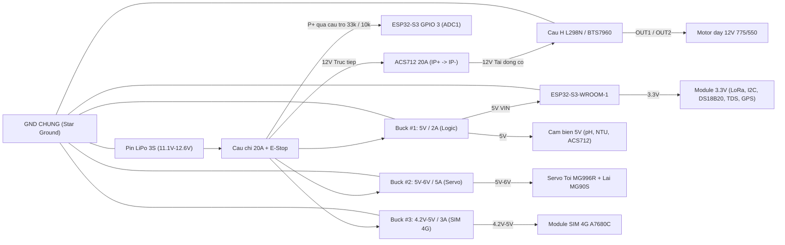
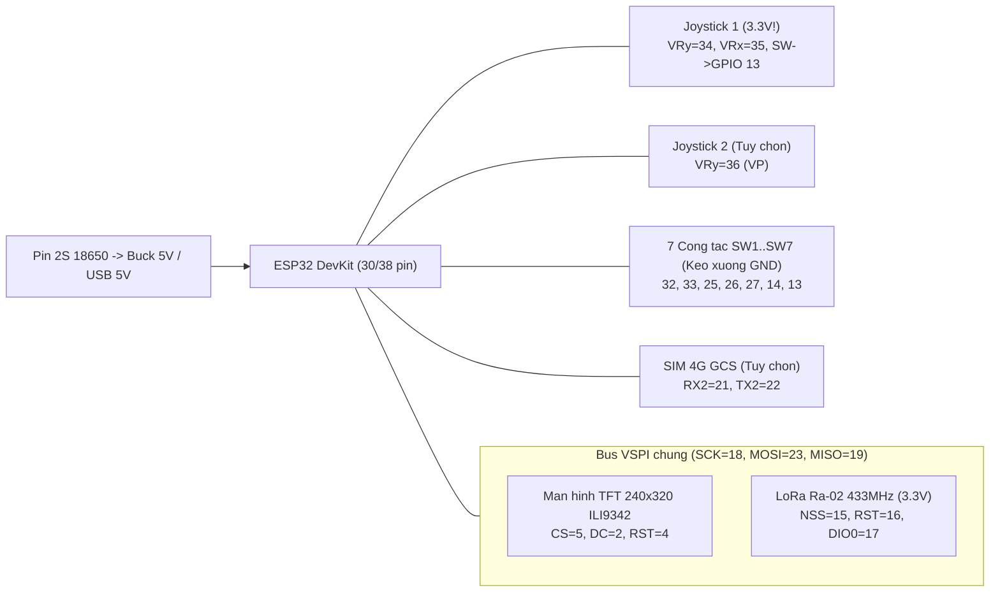

# Sơ Đồ Nối Dây Chi Tiết — ChemStation AI (USV Buoy & Trạm Bờ GCS)

Tài liệu được tổng hợp và đối chiếu trực tiếp từ mã nguồn firmware thực tế:
- Phao USV (ESP32-S3): [`src/usv_buoy/main.cpp`](../src/usv_buoy/main.cpp)
- Trạm bờ GCS (ESP32): [`src/ground_station/main.cpp`](../src/ground_station/main.cpp)
- Cấu hình màn hình TFT: [`platformio.ini`](../platformio.ini)

> **Cảnh báo:** File `export_components_to_excel.py` hiện có một số chân Trạm bờ GCS bị lệch (`DIO0=26`, thứ tự `SW1..SW7`). Khi đấu nối thực tế, **chỉ theo bảng bên dưới** để khớp 100% với firmware đang nạp.

---

## PHẦN 1: PHAO QUAN TRẮC TỰ HÀNH (USV BUOY — ESP32-S3-WROOM-1)

### 1.1 Sơ đồ khối tổng thể & phân phối nguồn

### 1.2 Bảng nối dây chi tiết ESP32-S3-WROOM-1

#### A. Nhóm Cảm biến Nước, Dòng điện & Đo Pin (ADC1 & 1-Wire)

| Linh kiện | Chân trên Module | Chân ESP32-S3 | Nguồn cấp | Ghi chú kỹ thuật quan trọng |
|---|---|---|---|---|
| **Mạch đo áp Pin 3S** | Điểm giữa cầu trở | `GPIO 3` | Từ `P+` Pin 3S | Đấu `P+` → trở **33kΩ** → `GPIO 3` → trở **10kΩ** → `GND` (tỉ số `4.30:1`, áp max ~2.93V) |
| **Cảm biến TDS** | `A` (Analog Out) | `GPIO 4` | `3.3V` (hoặc `5V`) | Ngõ ra `0–2.3V`, an toàn trực tiếp cho ADC1 |
| **Cảm biến Độ đục NTU** | `AO` (Analog Out) | `GPIO 5` | `5V` | Gạt công tắc sang chữ **A**. **Bắt buộc chia áp về ≤ 3.0V** (nếu >3.05V code báo `VUOTDAI`) |
| **Nhiệt độ nước DS18B20** | `DATA` (Dây vàng) | `GPIO 6` | `3.3V` | **Bắt buộc mắc điện trở kéo lên `4.7kΩ`** từ `GPIO 6` lên `3.3V` |
| **Cảm biến pH PH-4502C** | `Po` (Analog Out) | `GPIO 7` | `5V` | Đầu dò E-201-C cắm giắc BNC; dây `G` nối `GND` chung |
| **Cảm biến dòng ACS712 20A** | `OUT` | `GPIO 8` | `5V` | Mắc nối tiếp cực `+12V` cấp cho L298N qua 2 cọc domino `IP+` → `IP-` |

#### B. Nhóm Bus I2C chung (`100kHz`, nguồn `3.3V`)

Tất cả các module I2C đấu **song song** vào 2 chân `SDA` và `SCL`:

| Linh kiện | Địa chỉ I2C | `SDA` | `SCL` | `VCC` | `GND` | Ghi chú |
|---|---|---|---|---|---|---|
| **IMU 6 trục MPU6050** | `0x68` | `GPIO 1` | `GPIO 2` | `3.3V` | `GND` | Chân `AD0` để trống hoặc nối `GND` |
| **La bàn số GY-271** (QMC5883L / HMC5883L) | `0x0D` / `0x1E` | `GPIO 1` | `GPIO 2` | `3.3V` | `GND` | Đặt cách xa động cơ 775 & dây nguồn 12V tối thiểu 10–15cm |
| *(Tùy chọn)* **Áp suất nước MS5837** | `0x76` | `GPIO 1` | `GPIO 2` | `3.3V` | `GND` | Đo độ sâu thủy tĩnh thật (code tự nhận diện) |
| *(Tùy chọn)* **Encoder từ AS5600** | `0x36` | `GPIO 1` | `GPIO 2` | `3.3V` | `GND` | Đếm vòng rulo tời (code tự nhận diện) |

#### C. Nhóm Viễn thông & Định vị (LoRa SPI, SIM 4G UART2, GPS UART1)

| Linh kiện | Chân trên Module | Chân ESP32-S3 | Nguồn cấp | Ghi chú kỹ thuật |
|---|---|---|---|---|
| **LoRa Ra-02 (SX1278 433MHz)** | `NSS` (CS) | `GPIO 15` | **`3.3V` (Cấm 5V!)** | **Bắt buộc gắn ăng-ten 433MHz trước khi cấp nguồn** |
| | `SCK` | `GPIO 11` | | Bus SPI riêng, tránh chân PSRAM N16R8 |
| | `MISO` | `GPIO 13` | | |
| | `MOSI` | `GPIO 14` | | |
| | `RST` | `GPIO 21` | | |
| | `DIO0` | `GPIO 47` | | Chân ngắt nhận gói |
| **SIM 4G LTE A7680C** | `RXD` | `GPIO 41` (`TX2`) | **Buck #3 riêng (`4.2V–5V / 3A`)** | **Đấu chéo TX ↔ RX**, nối chung `GND` với ESP32-S3 |
| | `TXD` | `GPIO 42` (`RX2`) | | Không lấy nguồn từ chân 5V của ESP32 |
| **GPS NEO-6M** | `RX` | `GPIO 17` (`TX1`) | `3.3V` / `5V` | **Đấu chéo TX ↔ RX**, đặt ăng-ten gốm hướng lên trời |
| | `TX` | `GPIO 18` (`RX1`) | | |

#### D. Nhóm Động lực, Servo, Công tắc hành trình & Cứu hộ

| Linh kiện | Chân trên Module | Chân ESP32-S3 | Nguồn cấp | Ghi chú kỹ thuật |
|---|---|---|---|---|
| **Cầu H L298N** *(hoặc Motor Shield)* | `ENA` (`PWMA`) | `GPIO 16` | `12V` (qua ACS712) | Rút jumper trên `ENA` trước khi cắm dây PWM; LEDC ch 4 (5kHz) |
| | `IN1` (`DIRA`) | `GPIO 40` | | `OUT1` & `OUT2` nối 2 dây Motor 12V; gắn tụ `100nF` + diode TVS chống xung ngược |
| | `IN2` (`BRAKEA`) | `GPIO 12` | | Bắt buộc nối chung `GND` của L298N với `GND` ESP32-S3 |
| **Servo Tời MG996R 360°** | `SIG` (Cam/Vàng) | `GPIO 9` | **Buck #2 (`5V–6V / 5A`)** | Dây Đỏ → `+5V/6V Buck #2`, Dây Nâu → `GND` chung |
| **Servo Bánh lái MG90S** | `SIG` (Cam/Vàng) | `GPIO 10` | **Buck #2 (`5V`)** | Giới hạn góc lái 45°–135° trong firmware |
| **CT1 Hành trình Đáy bùn** | `NO` / `COM` | `GPIO 38` / `GND` | Nội (`INPUT_PULLUP`) | Kích hoạt mức LOW khi chạm đáy bùn |
| **CT2 Hành trình Home** | `NO` / `COM` | `GPIO 39` / `GND` | Nội (`INPUT_PULLUP`) | Kích hoạt mức LOW khi thu lồng về sát gầm (0.00m) |
| **Relay Solenoid Phao CO2** | `IN` (Active-HIGH) | `GPIO 45` *(Alt: `19`)* | `5V` / `12V` | **Chân Strapping `VDD_SPI`**: dùng mạch kích NPN + trở kéo xuống `10kΩ` |
| **Còi hú cứu hộ** | `IN` (Active-HIGH) | `GPIO 46` *(Alt: `20`)* | `5V` | **Chân Strapping Boot**: không kéo lên HIGH khi bật nguồn |
| **LED RGB WS2812** | Onboard | `GPIO 48` | Tích hợp trên bo | Báo trạng thái hệ thống bằng 6 màu |

---

## PHẦN 2: TRẠM QUAN SÁT BỜ (GCS — ESP32 DEVKIT + TFT 240×320)

### 2.1 Sơ đồ khối kết nối Trạm bờ

### 2.2 Bảng nối dây chi tiết ESP32 DevKit (Trạm bờ GCS)

#### A. Bus VSPI dùng chung (Màn hình TFT & LoRa Ra-02)

| Chân trên TFT (ILI9342) | Chân trên LoRa Ra-02 | Chân ESP32 DevKit | Ghi chú kỹ thuật |
|---|---|---|---|
| `SCK` (CLK) | `SCK` | `GPIO 18` | **Nối chung 2 module** (xung nhịp SPI 27MHz) |
| `SDI (MOSI)` | `MOSI` | `GPIO 23` | **Nối chung 2 module** |
| `SDO (MISO)` *(nếu dùng)* | `MISO` | `GPIO 19` | Bắt buộc nối cho LoRa Ra-02 |
| `CS` | — | `GPIO 5` | Chọn chip màn hình TFT |
| `DC` (`A0`/`RS`) | — | `GPIO 2` | Strapping pin — không kéo lên HIGH khi nạp code |
| `RESET` | — | `GPIO 4` | Reset cứng màn hình TFT |
| `LED` (Backlight) | — | `3.3V` | Hoặc qua trở `100Ω` lên `3.3V` |
| `VCC` / `GND` | — | `5V` *(hoặc `3.3V`)* / `GND` | Tùy board TFT có IC ổn áp 3.3V hay không |
| — | `NSS` (CS) | `GPIO 15` | Chọn chip LoRa |
| — | `RST` | `GPIO 16` | Reset phần cứng LoRa |
| — | `DIO0` | `GPIO 17` | Ngắt nhận gói tin LoRa |
| — | `VCC` / `GND` | **`3.3V` (Cấm 5V!)** / `GND` | Lắp ăng-ten 433MHz trước khi cấp nguồn |

#### B. Joystick Analog & 7 Công tắc / Nút nhấn tác chiến

> **Quan trọng:** Nguồn cho Joystick bắt buộc dùng **`3.3V`** (KHÔNG dùng `5V`).

| Linh kiện / Chức năng | Chân trên Module | Chân ESP32 DevKit | Cách đấu dây & Chức năng |
|---|---|---|---|
| **Joystick 1 — Ga Tiến/Lùi** | `VRy` | `GPIO 34` | Analog ADC1 (Đẩy Tiến / Kéo Lùi L298N) |
| **Joystick 1 — Bánh lái** | `VRx` | `GPIO 35` | Analog ADC1 (Bẻ lái 45°–135°) |
| **Joystick 1 — Nút nhấn đỉnh** | `SW` | `GPIO 13` *(khuyên dùng)* | Nút đa năng đọc trên `GPIO 13` (`SW7_PAGE_AUTO`, có `INPUT_PULLUP` nội) |
| **Joystick 2 (Tùy chọn Tời)** | `VRy` | `GPIO 36` (`VP`) | Analog ADC1 điều khiển Hạ / Thu tời |
| **SW1 — Tiến L298N** | 1 chân `SW` | `GPIO 32` | Chân còn lại nối `GND` (`INPUT_PULLUP`) |
| **SW2 — Lùi L298N** | 1 chân `SW` | `GPIO 33` | Chân còn lại nối `GND` (`INPUT_PULLUP`) |
| **SW3 — Rẽ Trái** | 1 chân `SW` | `GPIO 25` | Chân còn lại nối `GND` (`INPUT_PULLUP`) |
| **SW4 — Rẽ Phải** | 1 chân `SW` | `GPIO 26` | Chân còn lại nối `GND` (`INPUT_PULLUP`) |
| **SW5 — Hạ Tời** | 1 chân `SW` | `GPIO 27` | Chân còn lại nối `GND` (`INPUT_PULLUP`) |
| **SW6 — Thu Tời về Home** | 1 chân `SW` | `GPIO 14` | Chân còn lại nối `GND` (`INPUT_PULLUP`) |
| **SW7 — Nút đa năng** | 1 chân `SW` | `GPIO 13` | Chân còn lại nối `GND`: 1 click đổi 5 trang TFT \| đúp đổi tốc độ \| giữ >1.2s Auto 3 tầng |

#### C. SIM 4G dự phòng trên Trạm bờ (Tùy chọn)

| Linh kiện | Chân trên Module | Chân ESP32 DevKit | Ghi chú |
|---|---|---|---|
| **SIM 4G (A7680C / SIM7600)** | `TXD` | `GPIO 21` (`RX2`) | UART2 `115200 baud`, đấu chéo TX ↔ RX |
| | `RXD` | `GPIO 22` (`TX2`) | Cấp nguồn Buck `4.2V–5V / 3A` riêng + nối chung `GND` |

---

## PHẦN 3: CHECKLIST KIỂM TRA TRƯỚC KHI CẤP NGUỒN

1. Đo thông mạch kiểm tra không chạm chập giữa `12V–GND`, `5V–GND`, `3.3V–GND`.
2. Chỉnh điện áp các mạch Buck (`5.0V`, `5.0–6.0V`, `4.2–5.0V`) trước khi hàn vào tải.
3. Gắn đủ ăng-ten LoRa 433MHz & ăng-ten 4G trước khi bật nguồn.
4. Kiểm tra áp trên các chân ADC1 (`GPIO 3, 4, 5, 7, 8`) luôn ≤ `3.1V`.
5. Nối chung `GND` theo kiểu sao (Star Ground), tách riêng dây nguồn motor 775 khỏi dây I2C & cảm biến nước.
